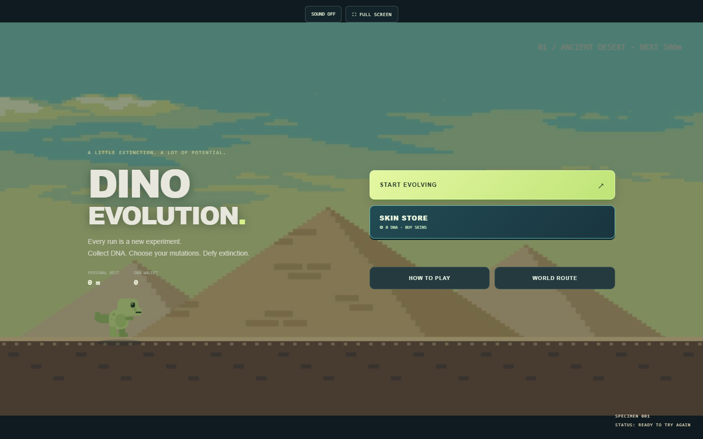
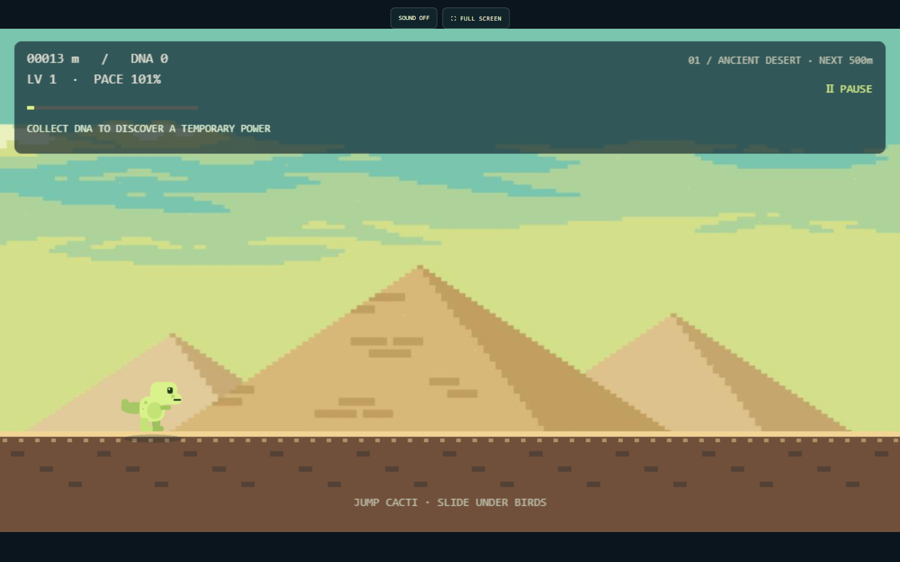

<div align="center">

# DINO / EVOLUTION

### Small dino. Big second chances.

Run. Adapt. Respawn. Turn your next attempt into your best one.

## [▶ Play free on itch.io](https://parag4lyfe90.itch.io/dino-evolution)

Launch the game in your browser. No installation required.

**PHASER 3 · JAVASCRIPT · VITE · HTML5**



**[Quick start](#quick-start) · [Controls](#controls) · [World route](#world-route) · [Build & test](#build--test)**

</div>

## Every run is a new experiment

A single-player browser runner built with Phaser and Vite. Jump over hazards,
slide under birds, collect DNA, and choose temporary mutations as you level up.
When extinction catches you, come back with another chance to break your record.

- **Six worlds to discover.** Start in the desert and push toward prehistoric ruins.
- **Evolve while running.** Choose a temporary power when Evolution Ready appears.
- **Make a comeback.** Use an earned charge near the spot where your previous run ended.
- **Find your look.** Preview cosmetic skins and buy them with earned DNA.
- **Keep your progress.** Records, wallet, skins, and interrupted runs save in your browser.
- **Play your way.** Keyboard controls, touch buttons, sound toggle, and fullscreen.



## Quick start

Install **Node.js 22.12+**, then run:

```bash
git clone https://github.com/parag4lyfe/dino-evolution.git
cd dino-evolution
npm ci
npm run dev
```

Open the address printed by Vite, usually **http://127.0.0.1:5173/**.
The repository is private, so cloning requires access.

### Windows launcher

Build once after cloning:

```bash
npm ci
npm run build
```

Then double-click **`START-GAME.cmd`**. The launcher opens the production build
at **http://127.0.0.1:5173/** and uses installed Node.js or the Codex bundled runtime.
Keep its terminal open while playing; press **Ctrl+C** to stop the server.
The prepared local copy already includes a build.

## Controls

| Action | Keyboard | Touch / on-screen |
| :--- | :--- | :--- |
| Jump | **Space** or **Up**; hold for height | **Jump** |
| Slide | **Down** | **Slide** |
| Pause / resume | **Esc** | Pause button / resume menu |
| Choose an evolution | **E** when ready, then select a card | Evolution Ready banner |
| Electric Dash | **X**, when unlocked | Dash button |
| Comeback Charge | **C**, near your previous crash point | Comeback button |
| Sound / fullscreen | Use the on-screen buttons | Use the on-screen buttons |

Your first completed run awards a one-time **300 DNA bounty**. Visit the skin
store to preview a look, buy or select it, and return to the game.

## World route

| Distance | World |
| ---: | :--- |
| 0 m | Ancient Desert |
| 500 m | Jungle |
| 1,000 m | Volcano |
| 1,500 m | Tundra |
| 2,500 m | Cyber City |
| 4,000 m | Prehistoric Ruins |

## Build & test

| Command | Purpose |
| :--- | :--- |
| `npm run dev` | Start the local development server |
| `npm test` | Run the 16 included tests |
| `npm run build` | Create the production build in `dist/` |
| `npm run preview` | Preview the production build locally |

The test suite covers progression, temporary powers, world unlocks, difficulty,
pickup clearance, skin purchases, save migration, first-run rewards, and comeback timing.

### HTML5 / itch.io release

Build the project, then ZIP **the contents of `dist/`** with `index.html` at the
archive root. Upload it as an **HTML game** on itch.io and mark the ZIP as playable
in the browser. Use click-to-launch fullscreen or a **1000 × 560** embed with
fullscreen support. The build uses relative asset paths for hosted embedding.

Serve the build over HTTP; opening `index.html` with `file://` is unsupported.
No game server or account login is required to play.

## Project map

```text
src/
  scenes/GameScene.js       Run loop, hazards, input, and game state
  entities/Dino.js          Player behavior
  systems/                 Worlds, progression, powers, store, and saves
  skinArt.js               Character artwork
  ui.js                    Menus, store, results, and evolution choices
public/maps/               Background images and provenance notes
tests/                     Gameplay and save-system tests
serve-local.cjs             Local production server
START-GAME.cmd              Windows launcher
```

## Saves & assets

Progress stays in the same browser and origin using localStorage and IndexedDB.
Use the same local URL to keep your save. Another browser, device, hostname,
or hosted version has a separate save; clearing site data removes local progress.

Character sprites and effects are drawn in code, and audio is synthesized.
Background provenance is documented in [public/maps/ASSETS.md](public/maps/ASSETS.md).
External reference images retain their original rights; this repository does not
claim a blanket license for those assets. Development used AI assistance.
